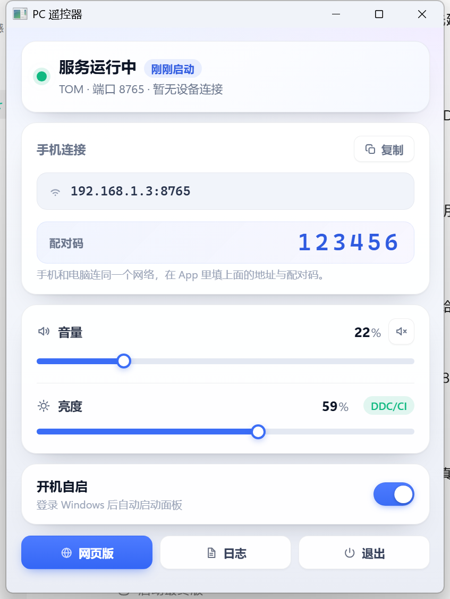

# PC 遥控器 · Android 控制 Windows 电脑

用手机调电脑的音量、亮度，还能静音、切歌、锁屏、休眠、远程唤醒。

- **PC 端**：Rust 单文件服务（347 KB，无运行库依赖，已配好开机自启）
- **PC 端备选**：Python 版，功能完全一致，方便随时改代码
- **手机端**：Kotlin + Compose 原生 App
- **手机不想装 App**：直接开浏览器访问电脑地址也能用（同一套接口）

```
PCControl/
├── server/                    电脑端（Rust 发布版，日常用这个）
│   ├── pccontrol-server.exe   单文件服务，零依赖
│   ├── pin.txt                配对码（当前 123456）
│   ├── start.bat              前台启动（能看到日志）
│   ├── start-hidden.vbs       静默启动（开机自启调用它）
│   ├── stop.bat               停止服务
│   ├── autostart-on.bat       开启开机自启
│   ├── autostart-off.bat      关闭开机自启
│   └── logs/server.log        运行日志
├── rust-server/               Rust 源码（cargo build --release）
├── pc-server/                 Python 版（备选，接口完全一致）
└── android/                   Android 工程（用 Android Studio 打开）
    └── app/src/main/java/com/workbuddy/pccontrol/
        ├── MainActivity.kt
        ├── net/  PcApi.kt  Discovery.kt  Wol.kt
        ├── data/ Store.kt
        └── ui/   ConnectScreen.kt  RemoteScreen.kt  Theme.kt
```

---

## 一、启动电脑端

**开机自启已经配好了**：每次登录 Windows 会自动启动，控制面板会直接弹出来。
想确认它是不是在跑：

```bash
curl http://127.0.0.1:8765/api/status
```

### 电脑端的界面

启动后会弹出**原生桌面面板窗口**（Rust + WebView2 渲染，单文件 exe，不是浏览器标签页）：



| 区域 | 内容 |
|---|---|
| 状态 | 服务运行中（呼吸绿点）、已运行时长、电脑名 · 端口、最近哪台手机连过 |
| 手机连接 | 内网地址 `192.168.1.3:8765`、6 位配对码大字，右上「复制」一键复制整段连接信息 |
| 实时 | 音量 / 亮度 滑块（拖动即时生效）、静音按钮、亮度模式徽标（`DDC/CI` / `HDR 已锁` / `软件调光`） |
| 开机自启 | 开关（写 HKCU Run 项，登录后自动启动面板） |
| 底部 | 网页版 / 日志 / 退出 |

界面本身是一份 HTML/CSS（`pc-server/panel.html`），编译时内嵌进 exe，
用 Windows 11 自带的 WebView2 渲染 —— 所以有真正的圆角卡片、阴影、滑块动效和高分屏清晰字体；
显示的数据来自本机 HTTP 接口（`127.0.0.1` 免配对码）。

行为约定：

- **关闭窗口（×）= 收起到托盘**，后台服务继续跑，手机照常能控制（首次关闭会提示一次）；
  再双击 `pccontrol-server.exe` 会把窗口重新叫出来（单实例，不会重复启动服务）。
- 只有点面板里的「退出」或托盘右键「退出」才真正结束进程。
- `--hidden` 参数 = 启动时不弹面板，只在后台运行。

另外还有两个附属入口：

- **系统托盘图标**（Win11 默认会折叠进 `^` 里）：左键打开面板，右键菜单含 打开面板 / 网页版 / 配对码 / 退出。
- **网页版控制台** `http://127.0.0.1:8765/`：界面和手机 App 一致（音量、亮度、媒体键、锁屏/关屏/休眠），
  用 `server/console.bat` 以 Edge/Chrome 应用窗口模式打开。**本机访问免配对码**，手机走局域网仍需 PIN。

手动控制（都在 `server/` 目录里，双击即可）：

| 想做什么 | 双击哪个 |
|---|---|
| 打开网页版控制台 | `console.bat` |
| 前台运行、看实时日志 | `start.bat` |
| 静默运行（无窗口，只有托盘图标） | `start-hidden.vbs` |
| 停止服务 | `stop.bat` |
| 关闭开机自启 | `autostart-off.bat` |
| 重新开启开机自启 | `autostart-on.bat` |

启动信息会写进 `server/logs/server.log`：

```
[16:07:05] PC Remote Server (Rust) 1.0.0 启动
[16:07:05] 亮度控制: ddc — 通过 DDC/CI 直接控制显示器背光
[16:07:05] 音量控制: 可用
[16:07:05] 监听地址: http://192.168.1.3:8765
[16:07:05] 本机控制台: http://127.0.0.1:8765/
[16:07:05] 配对码: 123456
[16:07:05] 本机名称: TOM
[16:07:05] 控制面板已就绪（WebView2 渲染）
[16:07:05] 托盘图标已添加（左键点击打开面板，右键菜单）
```

参数：

| 参数 | 说明 |
|---|---|
| `--port 8765` | HTTP 端口 |
| `--pin 123456` | 配对码（不传则沿用同目录 `pin.txt`，没有就随机生成一次） |
| `--hidden` | 启动时不弹面板，只在后台运行 |
| `--no-tray` | 不显示托盘图标 |
| `--hw` | 面板改用 GPU 渲染。默认走 SwiftShader 软件渲染，因为部分机器（含本机）WebView2 的 GPU 进程起不来会整片黑屏 |
| `--no-webview` | 不使用 WebView2 面板，回退到旧版 Win32 自绘面板 |

> 面板显示黑屏/空白时，先加 `--hw` 或 `--no-webview` 试一次，能立刻区分是渲染后端问题还是逻辑问题。

### 为什么改成 Rust

Python 版要靠虚拟环境，开机自启得把快捷方式指向 `pythonw.exe`，换台机器或删掉环境就失效。
Rust 版编译成**单个 387 KB 的 exe**，没有任何运行时依赖，双击就跑，更适合常驻。

### 开机自启是怎么实现的

`autostart-on.bat` 会在启动文件夹建一个快捷方式：

```
%APPDATA%\Microsoft\Windows\Start Menu\Programs\Startup\PC Remote Server.lnk
```

它指向系统自带的脚本宿主wscript.exe，参数是 `start-hidden.vbs`；
vbs 用隐藏窗口方式拉起 exe，所以**不会闪黑窗口**。想撤掉就双击 `autostart-off.bat`。

只在你**登录之后**触发，而不是按下电源键就跑 —— 这是故意的：音量、亮度、HDR
这些接口都依赖用户会话，跑在未登录的系统会话（session 0）里会失效。

**防火墙**：本机已经放行好了（规则名 `PC Remote 8765` / `PC Remote Discovery`，
覆盖 TCP 8765 与 UDP 55667，域/专用/公用三个配置文件全部允许）。

换电脑或规则被清掉时，双击 `pc-server/firewall-allow.bat`，在 UAC 弹窗点“是”即可重新添加；
也可以手动执行：

```powershell
netsh advfirewall firewall add rule name="PC Remote 8765" dir=in action=allow protocol=TCP localport=8765 profile=any
netsh advfirewall firewall add rule name="PC Remote Discovery" dir=in action=allow protocol=UDP localport=55667 profile=any
```

## 二、手机端

手机连**同一个 Wi-Fi**，两种方式任选：

1. **直接装现成的 APK**：把 `apk/PCControl-debug.apk` 传到手机安装即可。
   （小米/OPPO/vivo 会提示「未知来源应用」，允许本次安装即可；这是 debug 签名，仅供自用）
2. **浏览器**：直接打开 `http://192.168.1.3:8765`，输入配对码即可用，无需安装。

App 会自动局域网广播搜索电脑；搜不到就手动填 IP + 配对码。连过一次下次自动重连。

### 自动发现的范围（为什么会“搜不到”）

发现走 UDP 55667，分两步：

1. **广播**：`255.255.255.255` + 各网卡定向广播（如 `192.168.10.255`）。
   只能在**同一个网段**内生效，路由器不会把广播转发到别的网段。
2. **单播点名**：对上次连过的地址直接发一包（如 `192.168.1.3:55667`）。
   跨网段时只有这一步有效，因为单播会被正常路由/NAT。

实测本机就是这种情况：手机 192.168.10.10 → 电脑 192.168.1.3 之间隔了一层 NAT
（服务端看到的来源地址是 192.168.1.2），所以广播永远到不了，而单播一切正常。

结论：**第一次需要手动填一次 IP，之后 App 会用记住的地址自动发现并连接。**


### ⚠️ 前提：手机和电脑必须在同一个网段

电脑接网线、手机连 Wi-Fi 时，**这两者不一定是同一个网络**。判断方法：手机 Wi-Fi 详情里看 IP，
前三段要和电脑一致。

```
电脑 192.168.1.3   ←→ 手机 192.168.1.x   ✅ 通
电脑 192.168.1.3   ←→ 手机 192.168.10.x  ❌ 不通（两条独立的网络，互相 ping 都丢包）
```

不通时有两个选择：

1. 手机改连电脑所在路由器的 Wi-Fi（最省事）
2. 把电脑网线换到手机那台路由器的 LAN 口

### 没有同一网段时：USB 通道

手机用数据线连电脑（已开 USB 调试），双击 `usb-link.bat`，它会把手机本地的
`127.0.0.1:8765` 通过 USB 转发到电脑，然后在 App 里把电脑 IP 填 `127.0.0.1` 即可。
拔线失效，重新双击一次即可恢复。

### 自己重新编译

本机已装好的工具链（Android Studio 2026.2.1 + SDK API 35/37），命令行构建：

```bash
cd PCControl/android
export JAVA_HOME=C:/Users/lnzha/.workbuddy/toolchain/jdk-21.0.2
export ANDROID_HOME=C:/Users/lnzha/AppData/Local/Android/Sdk
C:/Users/lnzha/.workbuddy/toolchain/gradle-8.9/bin/gradle.bat assembleDebug
```

产物：`android/app/build/outputs/apk/debug/app-debug.apk`

工程配置：AGP 8.7.3 / Kotlin 2.0.21 / Gradle 8.9 / compileSdk 35 / minSdk 24 / JDK 21。
依赖走阿里云镜像（`settings.gradle.kts`），国内下载不会卡。

也可以在 Android Studio 里直接打开 `android/` 目录，把 Gradle JDK 指定为
`C:\Users\lnzha\.workbuddy\toolchain\jdk-21.0.2`（AS 自带的 JBR 是 JDK 25，与 AGP 8.7 不兼容）。


## 三、亮度为什么有时调不动（重要）

这是硬件层面的规则，不是程序的 bug：

| 显示器状态 | DDC/CI 读 | DDC/CI 写背光 |
|---|---|---|
| HDR **关闭** | ✅ | ✅ 真实背光可调 |
| HDR **开启** | ✅ | ❌ 显示器忽略写入（华硕、戴尔、LG 都一样） |

HDR 开启后背光由 HDR 元数据自动管理，厂家固件会直接忽略 0x10 的写入，所以
屏幕上看到的一切“能调亮度”的第三方工具，在 HDR 下都只是叠了一层半透明黑色遮罩。

本项目的处理方式（Rust 版）：

1. 走 **DDC/CI 真实背光**，启动时先把当前值写回去验证固件是否真的接受
2. HDR 开启时**不做假调光**：`/api/status` 的 `brightnessReason` 会直接写明
   「HDR 已开启，显示器背光被锁定」，亮度写入返回 `ok:false`
3. App 检测到「HDR 开 + 背光被锁」时，亮度卡片里会出现「关闭 HDR，启用真实背光」按钮，
   点一下调用 `POST /api/hdr`，约 1.5 秒后即可真实调节

Python 版额外有 WMI（笔记本内置屏）和覆盖层软件调光两层降级，但覆盖层只是在屏幕上
叠一层半透明黑，背光本身没变，截图里也会跟着变暗 —— 需要那种效果时才用 Python 版。

## 四、接口一览

所有接口需带请求头 `X-Pin: <配对码>`（`/` 和 `/api/ping` 除外）。

| 方法 | 路径 | 说明 |
|---|---|---|
| GET | `/api/status` | 音量、静音、亮度、亮度方式、HDR、MAC |
| POST | `/api/volume` | `{"value":0-100}` |
| POST | `/api/volume/step` | `{"delta":5}` |
| POST | `/api/mute` | 空对象切换 / `{"value":true}` 指定 |
| POST | `/api/brightness` | `{"value":0-100}` |
| POST | `/api/hdr` | `{"enabled":false}` 开/关 HDR |
| POST | `/api/media` | `{"action":"play_pause\|next\|prev\|stop"}` |
| POST | `/api/power` | `{"action":"lock\|sleep\|screen_off"}` |

UDP 自动发现：向 `255.255.255.255:55667` 发送 `PCREMOTE_DISCOVER`，
服务回 `{"app":"pccontrol","name":"TOM","port":8765,"ip":"192.168.1.3"}`。

## 五、常见问题

**手机连不上**
- 确认同一 Wi-Fi（很多路由器开了「AP 隔离」，会禁止设备互访，关掉它）
- 防火墙放行 8765/TCP 与 55667/UDP
- 用手机浏览器打开地址，能开就说明服务没问题

**唤醒（WoL）没用**
- 需要在 BIOS 打开 Wake-on-LAN，网卡属性里勾选「魔术包唤醒」
- 睡眠可用；完全关机是否成功取决于主板是否保持网卡供电

**退出后屏幕异常（只有软件调光模式会出现）**
直接关掉了进程时，遮罩窗口会随进程消失，无需处理；若用了 gamma 兜底，重新登录即可恢复。

**开机自启没生效**
- 看启动文件夹里有没有 `PC Remote Server.lnk`（双击 `autostart-on.bat` 会重新建）
- 手动双击 `server/start-hidden.vbs`，再看 `server/logs/server.log` 有没有报错
- 如果同时装过 Python 版的自启项，删掉重复的那个，否则两边会抢 8765 端口

**改了 Rust 代码怎么更新**
```bash
cd PCControl/rust-server
cargo build --release
cp target/release/pccontrol-server.exe ../server/
```
然后双击 `server/stop.bat` 再双击 `start-hidden.vbs` 重启（或直接重启电脑）。
